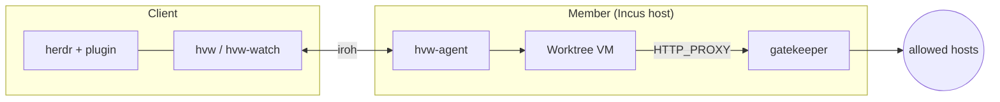

# herdr-vm-worktree

Run each [herdr](https://herdr.dev) worktree in its
own short-lived KVM VM on a remote Incus host. The VM holds no
credential. A per-VM egress gatekeeper adds the credentials and enforces
a domain allowlist. When an agent needs a refused host, you approve or
deny the request in herdr.



Start with the [documentation](docs/README.md). The
[architecture](docs/explanation/architecture.md) page explains the
components, the life of a VM, the store delivery and the control plane.
The [security model](docs/explanation/security-model.md) explains what
the VM can and cannot do. The code layout is in
[Develop and test this repo](docs/how-to/develop-this-repo.md#layout).

```sh
nix develop          # Rust, Nix and Python tools, language servers
cargo test           # unit tests
nix fmt              # treefmt: rustfmt and nixfmt
```
