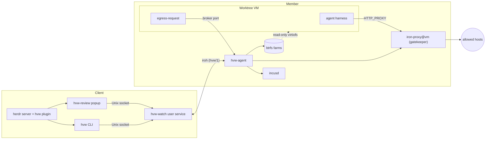
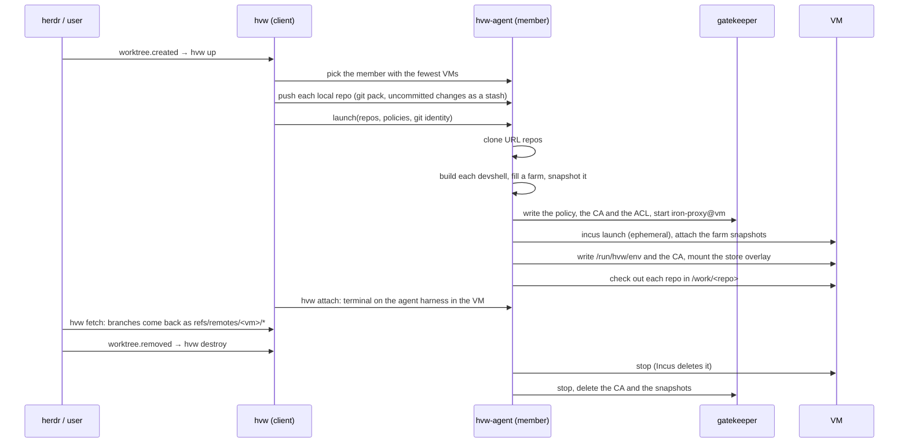

# Architecture

hvw has two kinds of machine. A **client** runs the herdr server. A
**member** is an Incus host that runs the worktree VMs. An optional
**relay** helps the client and the member find each other through NAT.

## Components

| Component | Runs on | Job |
|---|---|---|
| `hvw` | client | CLI. Launches, attaches to, syncs and destroys VMs. |
| `hvw-watch` | client | User service. Holds the iroh endpoint of the client. Watches the members for egress requests and tells herdr. |
| `hvw-review` | client | The herdr popup that shows the pending egress requests. |
| herdr plugin | client | Calls `hvw` when herdr creates or removes a worktree. |
| `hvw-agent` | member | Daemon. Owns the VMs, farms and gatekeepers of its member. Runs the egress broker. |
| `iron-proxy@<vm>` | member | The gatekeeper of one VM. MITM TLS proxy with an allowlist and secret injection. |
| base image | member | One generic NixOS image for all VMs. |
| `egress-request` | VM | Asks the user to allow a host that the gatekeeper refused. |

## The life of a worktree VM

## Store delivery

The VM never sees the store of its member. It gets only the closures of
its devshells.

1. `hvw-agent` builds `devShells.default` of each repo on the member.
2. If no farm exists for that output, `hvw-agent` makes a btrfs subvolume
   under `/var/lib/hvw/farms` and copies the closure into it with
   reflinks.
3. Each VM gets a read-only snapshot of each farm as a virtiofs disk.
4. In the VM, overlayfs stacks the snapshots under a writable
   `/nix/store`. `nix-store --load-db` registers the paths.
5. A login shell in `/work/<repo>` sources the devshell environment from
   the farm. The VM does not evaluate the flake.

Only the first launch after a change of `flake.lock` builds a farm. A
farm that no VM used for `farmRetentionDays` (default 14) goes away.
Reflinks need `/nix` and `/var/lib/hvw` on one btrfs filesystem.

## Source transfer

Git pack streams carry the source over the control plane, through
`hvw-agent` and `incus exec`. The VM needs no SSH, no inbound port and no
forge token.

- `hvw push` sends the commits as `refs/hvw/head` and the uncommitted
  changes as `refs/hvw/stash`.
- `hvw fetch` brings the branches of the VM back as
  `refs/remotes/<vm>/<branch>`.

## Control plane

All traffic between a client and a member uses
[iroh](https://iroh.computer) on the ALPN `hvw/1`. It does not use the
network of the clan. It works through NAT with the public n0 relays, or
with a self-hosted relay. Each machine has an iroh key from a clan var.
A member accepts only the clients of its clan service instance. A client
accepts only the members.

## Network filters on the member

Three filters guard the gatekeepers and the broker:

| Filter | Traffic | Lets through |
|---|---|---|
| Incus network ACL of each VM | from the VM | TCP to its own gatekeeper tunnel port and to the broker port |
| nftables `hvw-bridge`, input | from the bridge into the member | DHCP, DNS, the broker port, the tunnel ports |
| nftables `hvw-gatekeeper`, output | from member processes over `lo` | the gatekeeper ports for root only |

The last filter is necessary because local traffic does not go through
the bridge. Without it, each local user could use each gatekeeper.
`hvw-agent` runs as root. It connects to the tunnel port to check that a
gatekeeper is ready, and to the management port to reload a policy.

## Why one Incus per member, not a cluster

`hvw-agent` manages only its own member. The client picks the member. An
Incus cluster would add a shared database with a quorum of three and a
join with runtime tokens, but no function that hvw uses.
