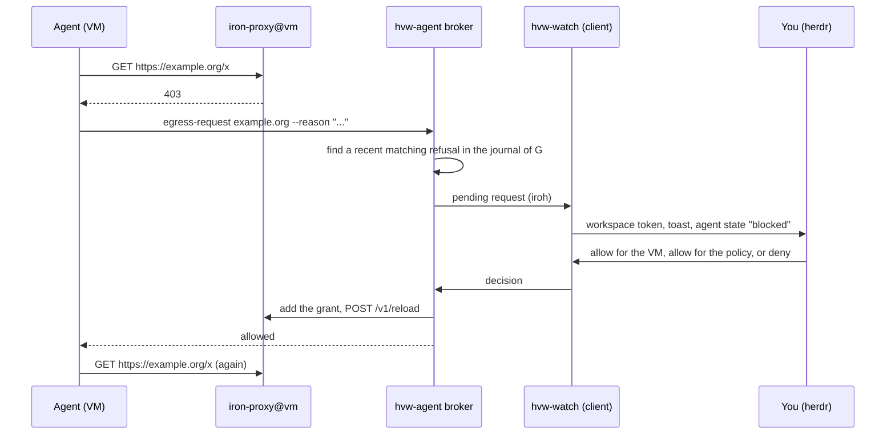
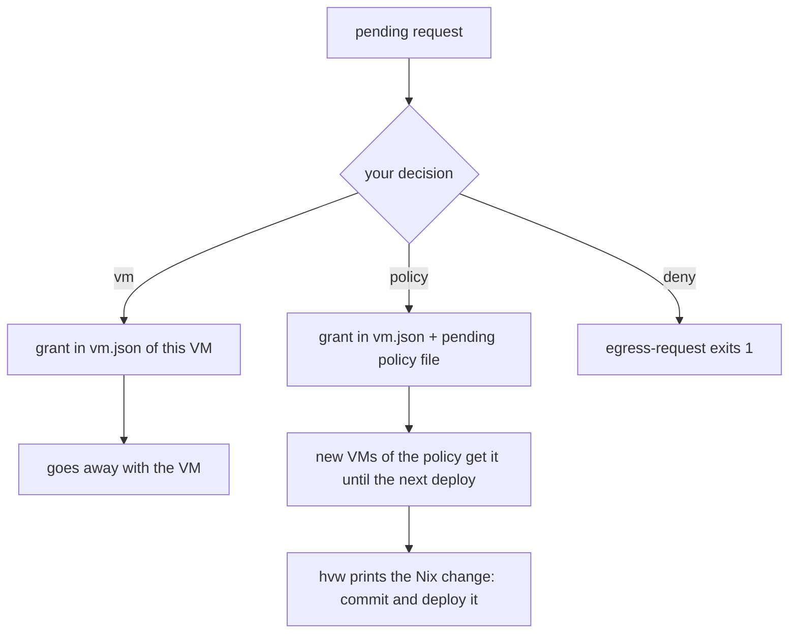

# Egress escalation

The gatekeeper of a VM refuses each host that its policy does not allow.
The agent gets status 403. If the task needs that host, the agent asks
you. You decide in herdr or with `hvw decide`.

## Why the broker needs a real refusal

The broker accepts a request only if the gatekeeper of that VM refused a
matching request recently. The popup then shows the exact host, method
and path that the gatekeeper refused, next to the reason of the agent.
You judge the real request, not only the words of the agent.

A request names a host, a method and a path. It never names a secret.

## The three decisions

- **vm**: the grant lives in the record of the VM. It goes away when the
  VM goes away.
- **policy**: new VMs of the same policies also get the grant, until the
  next deploy. To keep it, put the Nix change that `hvw` prints into the
  clan repo.
- **deny**: `egress-request` exits with status 1. The agent must not try
  again.

The broker waits 30 minutes for a decision. The broker reloads
iron-proxy through its management API, without a restart of the process.

## The risk

Your approval is the security control. An agent under prompt injection
can ask for an exfiltration host with a plausible reason. Read the host,
method and path in the popup, not only the reason.
