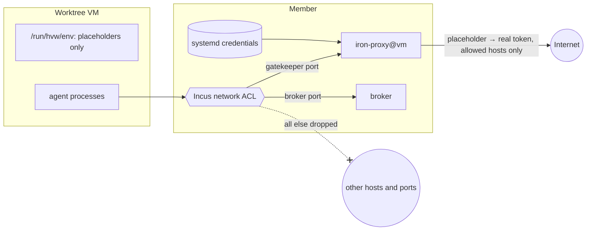

# Security model

The goal: an agent in a worktree VM can use credentials but cannot read
them, and can reach only the hosts that you allow.

## What hvw guarantees

- **No credential in the VM.** The VM holds placeholder strings, for
  example `GH_TOKEN=hvw-github-placeholder`. The gatekeeper puts the real
  value in place of the placeholder, only in requests to the hosts of the
  secret mapping.
- **Two ports, nothing else.** An Incus network ACL drops all traffic of
  the VM except its gatekeeper port and the broker port on the member
  bridge.
- **Only the devshell closures.** The VM gets read-only snapshots of its
  farms. It never sees the store of the member.
- **No way back to the client.** The VM has no herdr socket, no SSH and
  no route to the control plane.
- **Known peers only.** A member accepts only the iroh endpoint ids of
  the clients in its clan service instance.
- **One gatekeeper per VM.** Each VM has its own iron-proxy process, CA
  and audit log (`journalctl -u iron-proxy@<vm>`). One VM never sees the
  credentials or grants of another VM.
- **Only root on the member reaches a gatekeeper.** An nftables rule
  resets each new local connection to a gatekeeper port from a user
  that is not root. Other users and the `nixbld` fetchers of the
  devshell builds thus cannot use the credentials of a VM.

## What hvw does not protect against

- **Shared credentials in one VM.** Every process in a VM can use every
  credential of that VM.
- **Your approval.** An agent can ask for an exfiltration host. See
  [Egress escalation](egress-escalation.md).
- **Flake evaluation on the member.** `hvw-agent` builds the devshell of
  each repo on the member. A repo flake runs code there. Use trusted
  repos only.
- **Root on the member.** Root can read the credential files and use
  each gatekeeper. `hvw-agent` runs as root.
- **virtiofsd.** It runs on the member and is the attack surface of the
  store delivery.

## Limits that follow from the design

- A tool that ignores `HTTP_PROXY` and `HTTPS_PROXY` fails.
- The ACL allows TCP to two ports only. It blocks all other protocols.
- Credentials change only through Nix and a deploy, never at runtime.
- Do not give the VM a binary cache that it can read in full.
