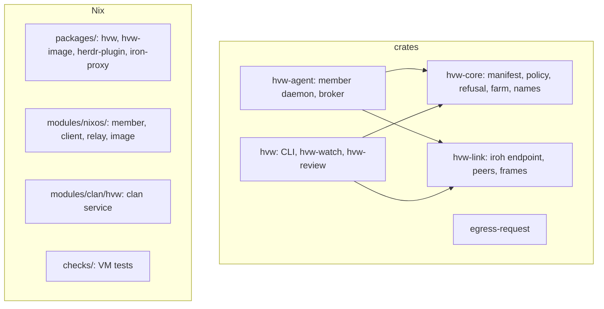

# Develop and test this repo

## Layout



The flake uses [blueprint](https://github.com/numtide/blueprint). Each
file under `packages/`, `modules/` and `checks/` is one output.

## Shell

```sh
nix develop      # or: direnv allow
```

The devshell holds the Rust toolchain, `incus`, the formatter and the
language servers for Rust, Nix, TOML and Python.

## Fast checks

```sh
cargo test --workspace
cargo clippy --workspace --all-targets -- --deny warnings
nix fmt
```

## Nix checks

```sh
nix build .#checks.x86_64-linux.pkgs-hvw          # build and unit tests
nix build .#checks.x86_64-linux.pkgs-hvw-clippy
nix build .#checks.x86_64-linux.clan              # evaluates the clan service
nix build .#checks.x86_64-linux.incus-vm          # one member boots a VM
nix build .#checks.x86_64-linux.e2e               # full round trip
```

| Check | Covers |
|---|---|
| `clan` | The clan service evaluates. Peers, relay and credentials are correct. |
| `incus-vm` | A member imports the image and boots a worktree VM. |
| `e2e` | Launch with a dirty repo and a devshell, credential injection, refused host, egress request and decision, fetch, destroy. |

`incus-vm` and `e2e` need nested KVM: the worktree VM runs at the third
level of nesting. On a host without it, they fail with a clear message.
In `e2e`, the `hvw launch` step alone takes about 4 minutes.

## Conventions

- TDD: each behaviour starts with a failing test. Tests use real
  programs, not mocks.
- Each commit builds and passes its checks.
- Kernel-style commit messages.
