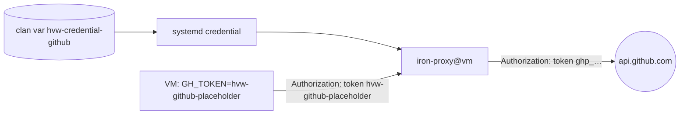

# Give a VM a credential

This example gives the VMs of the policy `github` a GitHub token for
`gh` and the GitHub API. The VM gets a placeholder, never the token.



## 1. Declare the credential and the policy

```nix
roles.member.machines.forge.settings = {
  credentials = [ "github" ];
  policies.github = {
    domains = [ "github.com" "api.github.com" "codeload.github.com" ];
    secrets = [
      {
        credential = "github";
        placeholder = "hvw-github-placeholder";
        hosts = [ "api.github.com" "github.com" ];
        env = [ "GH_TOKEN" ];
      }
    ];
  };
};
```

- `credentials` makes a shared clan var `hvw-credential-github`.
- `env` sets `GH_TOKEN` in the VM to the placeholder.
- The gatekeeper replaces the placeholder only in the `Authorization`
  header (the default of `headers`), and only for `hosts`.

## 2. Give the token and deploy

```sh
clan vars generate      # prompts for the token once
clan machines update forge
```

## 3. Use the policy

In `hvw.toml`:

```toml
[[repo]]
path = "."
policy = "github"
```

## Limits

- `gh` reads `GH_TOKEN`. `git push` over HTTPS does not. It needs a
  credential helper, for example `gh auth setup-git` in the VM.
- `gh` is not in the base image. Put it in the devshell of the repo.
- To change a credential, run `clan vars generate` again and deploy. A
  VM cannot change it.
