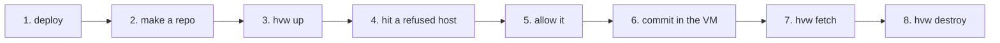

# Your first worktree VM

In this tutorial you start a worktree VM, see the gatekeeper refuse a
host, allow that host, and bring the work of the VM back. You use the
`hvw` CLI. herdr does the same steps for you later.



## What you need

- A clan with two machines: `forge`, a member with nested KVM, and
  `laptop`, a client with herdr. On `forge`, `/nix` and `/var/lib/hvw`
  are on one btrfs filesystem.
- The user `alice` on `laptop`, with a git `user.name` and `user.email`.

## 1. Deploy a member and a client

Add the flake input `hvw` as in [Deploy hvw with
clan](../how-to/deploy-with-clan.md), then this instance:

```nix
clan.inventory.instances.hvw = {
  module.input = "hvw";
  roles.member.machines.forge.settings.policies.tutorial.domains = [ "example.org" ];
  roles.client.machines.laptop.settings.user = "alice";
};
```

```sh
clan vars generate
clan machines update forge laptop
```

On `laptop`, as `alice`, check that the service runs:

```sh
systemctl --user status hvw-watch
```

## 2. Make a repo

```sh
mkdir ~/hello-hvw && cd ~/hello-hvw && git init
cat > flake.nix <<'EOF'
{
  inputs.nixpkgs.url = "github:NixOS/nixpkgs/nixos-unstable";
  outputs = { nixpkgs, ... }: {
    devShells.x86_64-linux.default =
      nixpkgs.legacyPackages.x86_64-linux.mkShell {
        packages = [ nixpkgs.legacyPackages.x86_64-linux.hello ];
      };
  };
}
EOF
cat > hvw.toml <<'EOF'
[[repo]]
path = "."
policy = "tutorial"
EOF
nix flake lock
git add . && git commit -m "hello hvw"
```

The VM gets the closure of this devshell, and nothing else from the
store.

## 3. Start the VM

```sh
hvw up
```

`hvw` reports each step: the push of the repo, the devshell build, the
gatekeeper, the boot and the checkout. The first `hvw up` takes some
minutes. Then you have a shell in `/work/hello-hvw` in the VM:

```sh
hello              # from the devshell
echo "$HTTPS_PROXY"
```

## 4. Hit a refused host

```sh
curl -s -o /dev/null -w '%{http_code}\n' https://example.org/        # 200: allowed
curl -s -o /dev/null -w '%{http_connect}\n' https://example.com/ || true  # 403: refused
```

The policy `tutorial` allows only `example.org`. The gatekeeper refused
`example.com`.

## 5. Ask for the host, and allow it

In the VM:

```sh
egress-request example.com --reason "the tutorial needs it"
```

The command waits. In a second terminal on `laptop`:

```sh
hvw pending
hvw decide <id> vm
```

`<id>` is the first column of `hvw pending`. In the VM,
`egress-request` prints `allowed (vm): make the request again`. Try
again:

```sh
curl -s -o /dev/null -w '%{http_code}\n' https://example.com/        # 200
```

The grant is for this VM only. It goes away with the VM.

## 6. Commit in the VM

```sh
echo "from the VM" > note.txt
git add note.txt && git commit -m "add a note"
exit
```

## 7. Bring the work back

On `laptop`, in `~/hello-hvw`:

```sh
hvw fetch
git branch -r                     # <vm>/<branch>
git log --oneline -1 <vm>/<branch>
```

## 8. Delete the VM

```sh
hvw destroy
```

Incus deletes the VM. The gatekeeper, its CA and the grant go away. The
farm of the devshell stays, so the next launch is faster.

## Next

- Let herdr do steps 3 and 8: link the plugin, as in [Deploy hvw with
  clan](../how-to/deploy-with-clan.md#4-link-the-herdr-plugin-on-the-client).
  A new worktree with `hvw.toml` then starts its VM in the root pane.
- Give the VM a real credential: [Give a VM a
  credential](../how-to/give-a-vm-a-credential.md).
- Read why it works this way: [Architecture](../explanation/architecture.md).
