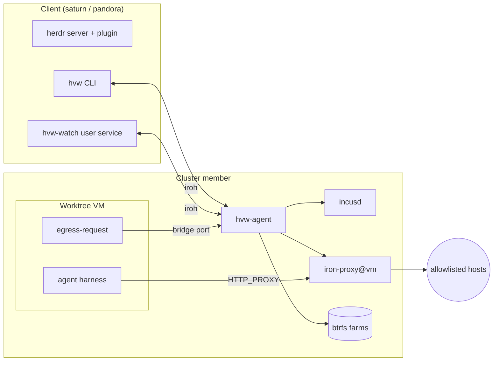
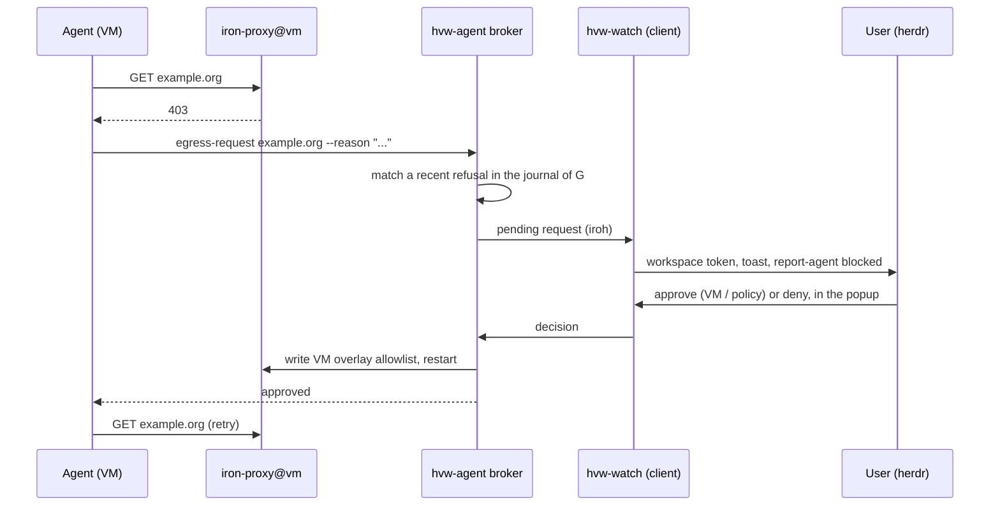

# herdr-vm-worktree: plan

## Goal

Run each herdr worktree in its own short-lived VM on a remote Incus
cluster. The VM holds no credential. A per-VM egress gatekeeper injects
credentials and enforces a domain allowlist. When an agent hits a refused
request that it needs, it asks for review. The user approves or denies the
request in herdr, and the agent continues.

The project is standalone. A clan imports it through a clan service
module and a NixOS module. It does not depend on the networking of the
clan that deploys it.

## Non-goals

- Live migration or failover of VMs. The VMs are short-lived worktrees.
  The loss of a member loses its worktrees, and that is acceptable.
- Shared cluster storage (Ceph) or overlay networks (OVN).
- Containers as the isolation boundary. Each worktree is a KVM VM.
- Credential changes at runtime. Secret mappings change only through Nix.
- Self-hosted iroh relays in the first version (see "Control plane").

## Terms

- **Member**: a host of the Incus cluster.
- **Client**: the machine that runs the herdr server and the `hvw` CLI
  (for example saturn or pandora).
- **Worktree VM**: one Incus VM for one herdr worktree workspace.
- **Gatekeeper**: the iron-proxy instance of one worktree VM.
- **Policy**: an allowlist, a set of secret mappings, an ACL and an
  Incus profile, defined in Nix.
- **Workspace manifest**: the list of repos and refs that one worktree VM
  receives.
- **Farm**: a btrfs subvolume that holds the store closure of one
  devshell, made with reflinks.

## Architecture

All traffic between client and member goes through the control plane
(iroh). The VM reaches only its gatekeeper port and its broker port on the
bridge of its member.

## Components

### Cluster

- Hetzner dedicated servers (Robot). Hetzner Cloud servers give no
  nested KVM, so they cannot run worktree VMs.
- Three members in one location, for database quorum. Two members work
  but give no fault tolerance for the cluster database.
- Each member has one btrfs filesystem for `/nix` and
  `/var/lib/hvw`. Reflinks need one filesystem.
- Incus cluster with a local btrfs storage pool on each member.
- One Incus bridge on each member. No OVN.
- The members use the same Incus version.

### Base image

- One generic NixOS image, built by this flake. It holds the agent
  harness, git, direnv, nix-direnv, `egress-request`, and the boot hooks
  for the CA, the proxy variables and the store overlay.
- The image changes rarely. It does not contain any repo devshell.
- Each worktree VM is a copy-on-write clone of the image on the local
  pool, launched with `incus launch --ephemeral`. Incus deletes the VM
  when it stops.

### Store delivery

The VM must not see the host store. It receives only the closures of
its devshells.

1. `hvw-agent` evaluates and realises `devShells.default` of each repo
   in the workspace manifest, on the member.
2. If no farm exists for the devshell output path, `hvw-agent` creates
   the subvolume `/var/lib/hvw/farms/<hash>` and fills it with
   `cp -a --reflink=always` for each path of the closure. It also writes
   the `closureInfo` registration data into the farm.
3. For each VM, `hvw-agent` makes a read-only snapshot
   `/var/lib/hvw/vms/<vm>/store/<repo>` of each farm.
4. Incus gives each snapshot to the VM as a read-only directory disk
   (virtiofs).
5. In the VM, overlayfs stacks the snapshots as lower layers under a
   writable upper layer on `/nix/store`. Store paths are unique by hash,
   so the layers do not conflict. The VM loads the registration data with
   `nix-store --load-db`.
6. At teardown, `hvw-agent` deletes the VM snapshots. A farm that no VM
   used for N days is deleted.

Properties:

- Farms have their own inodes. Host GC and `nix-store --repair` do not
  touch them.
- The cost per VM is constant. Only the first launch after a change of
  `flake.lock` builds a farm.
- `virtiofsd` is the attack surface on the host. This is accepted.
- The farm and VM subvolumes must stay out of btrbk or any other
  snapshot tool.

Risks:

- Evaluation runs on the member. A repo flake runs code and builds on the
  member Nix daemon. This is acceptable for trusted repos only.
- Reflinks across different mount points of one btrfs filesystem may
  need a recent kernel. Work through one mount.

### Source transfer

- The `hvw` CLI pushes each repo of the workspace manifest into
  `/work/<repo>` in the VM. Uncommitted changes travel as a
  `git stash create` commit.
- Work comes back with `git fetch` from the VM.
- Both directions use git pack streams over the control plane, through
  `hvw-agent` and `incus exec`. The VM needs no SSH, no inbound port and
  no forge token.
- `hvw-agent` writes `.envrc` with `use flake` into each repo directory.
  Each repo gets its own shell.

### Workspace manifest

- A small file lists each repo, its ref or local path, and the policy.
- One VM has one gatekeeper. The policy of a multi-repo workspace is the
  union of the domains and secret mappings of its repos.
- Format: TOML or JSON, decided in the first milestone.

### Egress gatekeeper

- A systemd template unit `iron-proxy@<vm>.service` on each member.
  One gatekeeper process for each VM. iron-proxy cannot tell which client
  sent a request, so a shared process would mix the credentials and the
  audit logs of VMs.
- MITM TLS mode, as in the lemmy gatekeeper of the sol clan.
- Nix builds the policies at deploy time. At launch, `hvw-agent` binds a
  policy to a port, a CA and a VM.
- A CA for each VM, made at launch with `iron-proxy generate-ca` and a
  short expiry. The key stays on the member and is deleted with the VM.
- Secrets come from clan vars through `LoadCredential`. Every member holds
  the secrets of every policy that it can run.
- An Incus network ACL denies all egress of the VM except the gatekeeper
  port and the broker port on the member bridge address.
- An Incus profile for each policy sets `HTTP_PROXY`, `HTTPS_PROXY`,
  `NODE_EXTRA_CA_CERTS`, the placeholder strings and the CA path through
  cloud-init or the image boot hooks.
- The audit log of one VM is `journalctl -u iron-proxy@<vm>`.

Limits:

- A tool that ignores the proxy variables fails.
- Protocols other than HTTP(S) are blocked unless the ACL allows them.
- Every process in a VM can use the credentials of that VM.
- Do not give the VM a cache that it can read in full (for example
  niks3 through `aws_auth`). The VM receives only cache.nixos.org and its
  farms.

### Egress escalation

1. The agent gets status 403 from its gatekeeper.
2. The agent runs `egress-request <host> [--method M --path P]
   --reason "..."`. The command blocks until a decision or a timeout. A
   skill tells the agent to use it.
3. The broker in `hvw-agent` accepts the request only if the gatekeeper
   of that VM refused a matching request recently. The user sees the real
   refused request next to the reason of the agent.
4. A request names domains, methods and paths only. It never names a
   secret.
5. The user selects one scope:
   - **VM**: the broker writes `/var/lib/hvw/vms/<vm>/egress.json` and
     restarts the gatekeeper. The grant goes away with the VM.
   - **Policy**: the grant also goes into a pending policy file. New VMs
     of that policy receive it until the next deploy. `hvw` prints the Nix
     change for the clan repo, and the user commits and deploys it.
   - **Deny**: the request of the agent returns an error.
6. A restart of the gatekeeper drops open connections of that VM. Check
   whether iron-proxy can reload its config without a restart.

Risk: the human approval is the security control. An agent under prompt
injection asks for an exfiltration host with a plausible reason. The
popup must show the exact host, method and path, not only the summary of
the agent. A policy grant must need more steps than a VM grant.

### Control plane (iroh)

- Every link between client and member uses iroh: VM lifecycle, terminal
  attach, git streams, egress requests and decisions, agent state.
- The control plane does not use the network of the deployed clan (for
  example a tailnet). It works through NAT with the public n0 relays.
- First version: the default n0 relays. Later: self-hosted
  `iroh-relay` (in nixpkgs) as an option of the clan service.
- Each node has an iroh secret key from a clan var. The clan service
  shares the public endpoint ids of all members and clients.
- Each Rust program that talks over the control plane embeds iroh as a
  library: `hvw-agent` on a member, `hvw` and `hvw-watch` on a client.
  One shared crate, `hvw-link`, holds the endpoint logic:
  - It loads the node secret key and the allowlist of peer endpoint ids
    from files that the clan service writes.
  - It accepts connections only from peers in the allowlist, on one
    ALPN (`hvw/1`).
  - It gives the caller the authenticated peer endpoint id with each
    connection, so that `hvw-agent` knows which client calls.
- VM tests have no internet. The tests must use direct addresses with the
  relay off.

### herdr integration

The herdr plugin API of herdr 0.9.3 provides the parts below.

- `[[events]] on = "worktree.created"` launches the VM for the new
  workspace. `on = "worktree.removed"` destroys it. The hook receives the
  workspace and the checkout in `HERDR_PLUGIN_EVENT_JSON`.
- The root pane runs `hvw attach <vm>`, which gives a terminal into the
  agent harness in the VM over the control plane.
- `herdr workspace report-metadata <ws> --source hvw --token
  egress=<n>-pending` shows pending requests on the workspace row. The
  sidebar row format must name `$egress`.
- `herdr notification show ... --sound request` raises a toast.
- A `[[panes]]` entry with `placement = "popup"` holds the review TUI. A
  `[[keys.command]]` entry with `type = "plugin_action"` opens it.
- `herdr pane report-agent <pane> --source hvw --agent <label> --state
  blocked --message ...` reports the agent state. Then
  `herdr pane release-agent`. The herdr socket never enters the VM.
- `[[startup]]` hooks run once and are not supervised. The broker watcher
  is therefore a separate systemd user service, `hvw-watch`, next to the
  herdr server. The popup and `hvw-watch` share state through files under
  `HERDR_PLUGIN_STATE_DIR`.
- The herdr server runs on the client. Plugin hooks and `hvw-watch` run
  there too. Worktrees depend on the client staying awake.

### Clan integration

- A clan service module with the roles `member` and `client`.
  - `member`: Incus cluster, btrfs layout checks, `hvw-agent`,
    `iron-proxy@` template, policies, vars for the iroh key and the
    policy secrets.
  - `client`: `hvw` CLI, `hvw-watch` user service, the herdr plugin, the
    iroh key var.
- Policies are settings of the service instance.
- A plain NixOS module for each role, so that a configuration without
  clan can use it.
- Check the current clan-core convention for the flake output of a clan
  service module.

## Security model

- The VM holds placeholders only. Real credentials stay in the
  gatekeeper on the member.
- The VM reaches two ports on its member and nothing else.
- The VM sees only the closures of its devshells, never the host store.
- The VM has no herdr socket, no SSH and no route to the control plane.
- The member trusts only iroh peers that are in the clan service.
- Residual risks: virtiofsd on the member, evaluation of repo flakes on
  the member, credentials shared by all processes in one VM, and human
  approval of egress grants.

## Development

- A Nix flake based on `numtide/blueprint`, with the blueprint layout:
  `packages/`, `modules/nixos/`, `modules/clan/`, `checks/`,
  `devshell.nix`, `formatter.nix`.
- `formatter.nix` uses `treefmt-nix`: `rustfmt` and `nixfmt`, with a
  `clippy` check.
- Rust for all project code, in one Cargo workspace: `hvw`, `hvw-agent`,
  `hvw-watch`, `egress-request`, the review TUI and the `hvw-link`
  crate. Add a second language only for a compelling reason, and record
  the reason here.
- iron-proxy is a third-party Go program. The flake packages it from
  source. This is not project code.
- `hvw-agent` talks to the Incus REST API on the local Unix socket. For
  `exec` streams, it may run the `incus` CLI if the websocket protocol
  of the API costs too much to implement.
- TDD. Each behaviour starts with a failing test.
  - Rust unit tests for pure logic: policy merge, refusal matching,
    manifest parsing, farm planning, peer allowlist.
  - NixOS VM tests in `checks/` for each integration path: gatekeeper
    and ACL, farm and snapshot, source push and fetch, escalation round
    trip, control plane between two nodes.
- Tests use realistic inputs and the real programs, not mocks.
- Worktree VMs inside a NixOS VM test need nested KVM. The development
  guest `lemmy` has `/dev/kvm`, `kvm_amd` with `nested=1`, and the Nix
  system features `kvm` and `nixos-test`. A NixOS test VM with
  `virtualisation.qemu.options = [ "-cpu host" ]` sees `/dev/kvm` and
  `nested=1` too (checked 2026-10-25). An Incus VM inside the test VM is
  the third level of nesting. Its boot time is not measured yet. On a
  host without nested KVM, the test must fail with a clear message, not
  skip in silence.
- Atomic commits. Each commit builds, and its checks pass, so that
  `git bisect` works.
- Kernel-style commit messages: a short subject with a subsystem prefix,
  and a short body that gives the reason for the change.

## Milestones

1. **Skeleton**: blueprint flake, treefmt-nix, devshell, Cargo
   workspace, a first VM test that boots one node and starts an Incus VM
   in it. Decide the manifest format.
2. **Gatekeeper**: iron-proxy package, `iron-proxy@` template, per-VM CA,
   Incus ACL and profile. VM test: allowed host passes, refused host gets
   403, placeholder replaced, other ports blocked.
3. **Store delivery**: farms, snapshots, overlay and `--load-db` in the
   base image. VM test: devshell works in the VM, a path outside the
   closure is absent.
4. **Source transfer**: push and fetch of git streams through
   `incus exec`. VM test: round trip with an uncommitted change.
5. **Control plane**: `hvw-link` crate, peer allowlist, `hvw-agent` API,
   `hvw attach`. VM test: two nodes, direct addresses, relay off,
   unknown peer refused.
6. **Escalation**: `egress-request`, broker, refusal matching, VM and
   policy scopes. VM test: refused, requested, approved, retried.
7. **herdr**: plugin manifest, worktree hooks, `hvw-watch`, popup,
   tokens, toasts, `report-agent`.
8. **Clan**: clan service module, roles, vars, example inventory.
9. **Self-hosted relay**: optional `iroh-relay` role.

## Open questions

- Boot time of an Incus VM at the third level of nesting in VM tests.
- Can iron-proxy reload its config without a restart?
- Does herdr screen detection see the agent behind `hvw attach`? The
  `report-agent` path works either way.
- Exact flake output name for a clan service module.
- Retention period for unused farms.
- Workspace manifest format and location.
